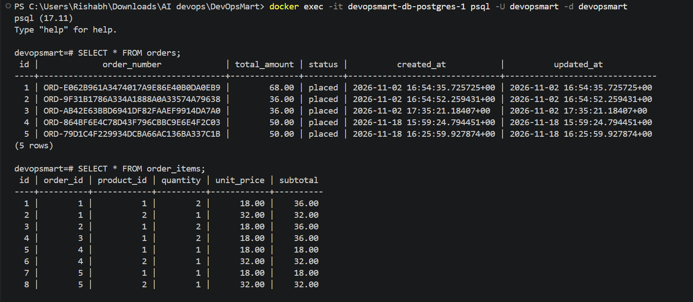
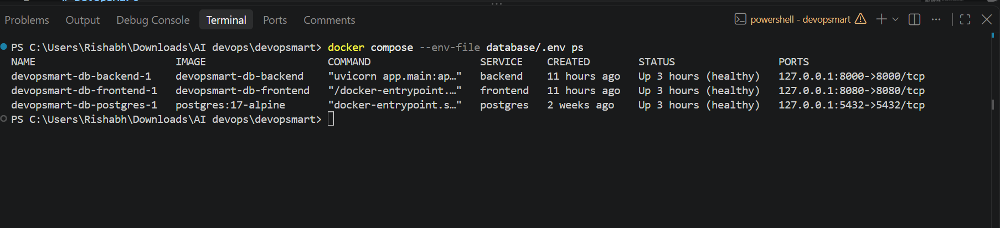

DEVOPSMART

Production-Grade Three-Tier Application with End-to-End DevOps, DevSecOps & AI-Powered Self-Healing Infrastructure.

## PROJECT-OVERVIEW
**DevOpsMart** is a production-grade, three-tier e-commerce application built to demonstrate end-to-end DevOps and DevSecOps practices. It uses React.js for the frontend, FastAPI for the backend, and PostgreSQL for data storage.

The application is containerized using Docker and deployed on Kubernetes, with CI/CD pipelines automated through GitHub Actions. DevSecOps tools are integrated for security scanning, while Prometheus and Grafana provide infrastructure monitoring and observability.

The platform also features an **AI-powered Incident Management and Self-Healing System** that analyzes infrastructure issues, identifies potential root causes, and performs controlled automated remediation for predefined problems.

The project demonstrates the complete application lifecycle, from development and deployment to security, monitoring, incident management, and automated recovery.

## Tech Stack

- **Frontend:** React.js, Vite, JavaScript, HTML5, CSS3
- **Backend:** Python, FastAPI, REST APIs, SQLAlchemy, Alembic
- **Database:** PostgreSQL, Psycopg
- **Containerization & Web Server:** Docker, Docker Compose, Nginx
- **Kubernetes & Orchestration:** Kubernetes, kind, Helm, Deployments, Services, ConfigMaps, Secrets, PV, PVC, HPA, RBAC
- **CI/CD:** Git, GitHub, GitHub Actions
- **DevSecOps & Security:** Trivy, SonarQube, OWASP, SAST, Container Image Scanning, Dependency Scanning, Secrets Detection
- **Monitoring & Observability:** Prometheus, Grafana, Alertmanager, Node Exporter, cAdvisor, Metrics Server
- **AI & Self-Healing:** OpenAI API, LLMs, Python, FastAPI, LangChain, Kubernetes Python Client
- **Infrastructure as Code:** Terraform, Ansible
- **Testing:** Pytest, Vitest, React Testing Library, Postman
- **Development Tools:** VS Code, PowerShell, Linux, Bash, YAML
- **Version Control:** Git, GitHub

## Application Development

Developed a three-tier e-commerce application using React, FastAPI, and PostgreSQL. Implemented product listing, shopping cart, order management, database models, and migrations. Added health check endpoints, structured JSON logging, request ID middleware, and automated frontend and backend tests.

## Dockererization

The application is containerized using Docker and Docker Compose. All three services run locally in separate containers and communicate through a dedicated Docker network.

1-Multi-stage frontend Dockerfile.
2-Backend Dockerfile.
3-Nginx-based frontend container.
4-PostgreSQL container using the official image.
5-Docker Compose configuration for all three services.
6-Dedicated Docker network for service communication.
7-Persistent PostgreSQL named volume.
8-Container health checks.
9-Health-based service startup dependencies.
10-Nginx reverse proxy for backend API requests.
11-Container-to-container communication verification.
12-Application image and secret audit.

## Docker compose

Inside Docker Compose, services communicate using their service names:
Frontend → backend:8000
Backend → postgres:5432
The browser accesses the application through http://localhost:8080.

## How to run the application

1-install docker desktop and check these commands
docker --version
docker compose version
git --version

2-clone the project from the github
cd Desktop
git clone YOUR_GITHUB_REPOSITORY_URL
cd DevOpsMart

3-configure env file
Copy-Item database/.env.example database/.env
notepad database/.env

4-Docker cotainers build and start
command-  docker compose --env-file database/.env -f compose.yaml -p devopsmart-db up -d --build
this will do
Builds the frontend Docker image.
Builds the backend Docker image.
Creates and starts the PostgreSQL container.
Connects all three services through a Docker network.
Creates a persistent volume for the database.
Runs all containers in the background.

5-check status of containers
command-  docker compose --env-file database/.env -f compose.yaml -p devopsmart-db ps
all containers should be healthy

6- open application in the browser
http://localhost:8080/
backend helath check    http://localhost:8000/health

7-verify postgress database
docker exec -it devopsmart-db-postgres-1 psql -U devopsmart -d devopsmart
product verify = SELECT * FROM products;
orders verify =SELECT * FROM orders;
order items verify =SELECT * FROM order_items;

for stop the application
docker compose --env-file database/.env -f compose.yaml -p devopsmart-db stop

to start the application
docker compose --env-file database/.env -f compose.yaml -p devopsmart-db start