DEVOPSMART

Production-Grade Three-Tier Application with End-to-End DevOps, DevSecOps & AI-Powered Self-Healing Infrastructure.

## PROJECT-OVERVIEW
**DevOpsMart** is a production-grade, three-tier e-commerce application built to demonstrate end-to-end DevOps and DevSecOps practices. It uses React.js for the frontend, FastAPI for the backend, and PostgreSQL for data storage.

The application is containerized using Docker and deployed on Kubernetes, with CI/CD pipelines automated through GitHub Actions. DevSecOps tools are integrated for security scanning, while Prometheus and Grafana provide infrastructure monitoring and observability.

The platform also features an **AI-powered Incident Management and Self-Healing System** that analyzes infrastructure issues, identifies potential root causes, and performs controlled automated remediation for predefined problems.

The project demonstrates the complete application lifecycle, from development and deployment to security, monitoring, incident management, and automated recovery.

## Tech Stack

- **Frontend:** React.js, Vite, JavaScript, HTML5, CSS3
- **Backend:** Python, FastAPI, REST APIs, SQLAlchemy, Alembic
- **Database:** PostgreSQL, Psycopg
- **Containerization & Web Server:** Docker, Docker Compose, Nginx
- **Kubernetes & Orchestration:** Kubernetes, kind, Helm, Deployments, Services, ConfigMaps, Secrets, PV, PVC, HPA, RBAC
- **CI/CD:** Git, GitHub, GitHub Actions
- **DevSecOps & Security:** Trivy, SonarQube, OWASP, SAST, Container Image Scanning, Dependency Scanning, Secrets Detection
- **Monitoring & Observability:** Prometheus, Grafana, Alertmanager, Node Exporter, cAdvisor, Metrics Server
- **AI & Self-Healing:** OpenAI API, LLMs, Python, FastAPI, LangChain, Kubernetes Python Client
- **Infrastructure as Code:** Terraform, Ansible
- **Testing:** Pytest, Vitest, React Testing Library, Postman
- **Development Tools:** VS Code, PowerShell, Linux, Bash, YAML
- **Version Control:** Git, GitHub

## Application Development

Developed a three-tier e-commerce application using React, FastAPI, and PostgreSQL. Implemented product listing, shopping cart, order management, database models, and migrations. Added health check endpoints, structured JSON logging, request ID middleware, and automated frontend and backend tests.
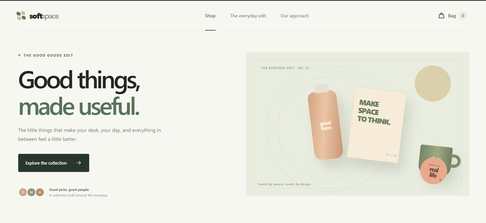

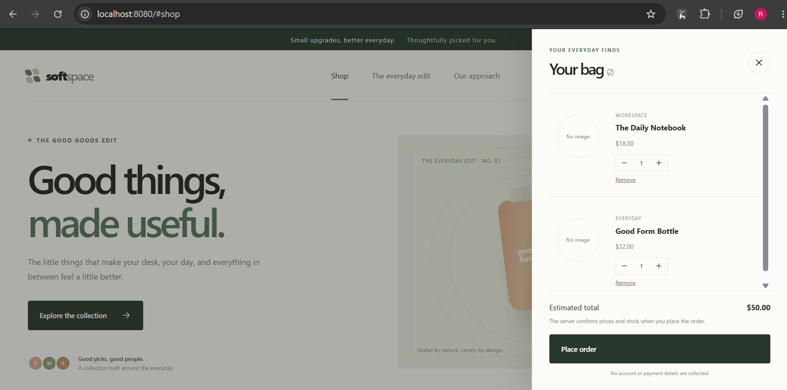

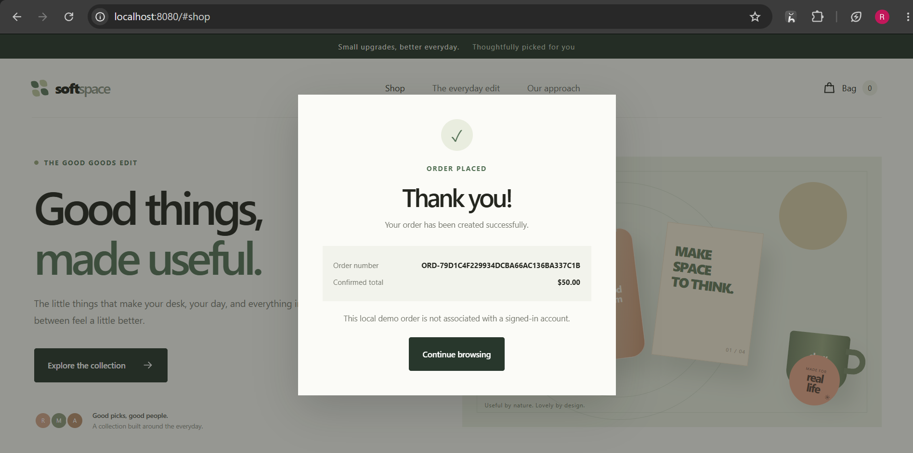

## Dockererization

The application is containerized using Docker and Docker Compose. All three services run locally in separate containers and communicate through a dedicated Docker network.

1-Multi-stage frontend Dockerfile.
2-Backend Dockerfile.
3-Nginx-based frontend container.
4-PostgreSQL container using the official image.
5-Docker Compose configuration for all three services.
6-Dedicated Docker network for service communication.
7-Persistent PostgreSQL named volume.
8-Container health checks.
9-Health-based service startup dependencies.
10-Nginx reverse proxy for backend API requests.
11-Container-to-container communication verification.
12-Application image and secret audit.

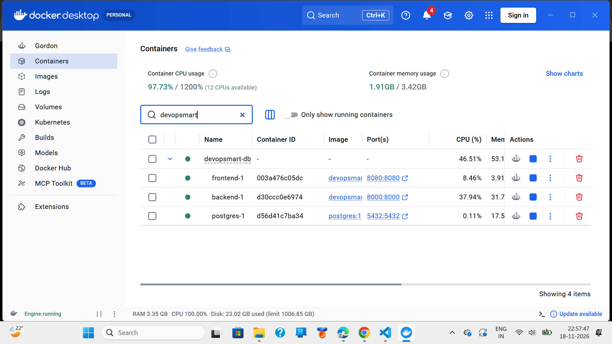

## Docker compose

Inside Docker Compose, services communicate using their service names:
Frontend → backend:8000
Backend → postgres:5432
The browser accesses the application through http://localhost:8080.

## Kubernetes Deployment

After completing the Docker setup, I moved the application to Kubernetes to understand how the different services work together inside a cluster.

For local deployment, I used **kind (Kubernetes in Docker)**. It allowed me to run a Kubernetes cluster locally without depending on any cloud infrastructure.

I created a separate kind cluster for DevOpsMart and used it to deploy the frontend, backend, and PostgreSQL database.

### 1. Setting up the Kubernetes Cluster

I installed kind and kubectl on my Windows machine and created a local Kubernetes cluster named `devopsmart`.

The cluster uses a single control-plane node to keep the resource usage low while running locally.

I also kept the existing Docker Compose setup separate from Kubernetes, so both deployment methods can be used independently.

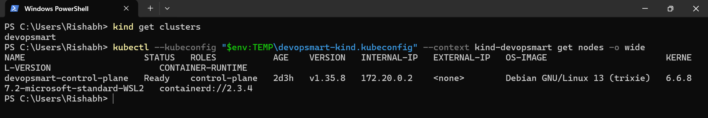

### 2. Loading Docker Images into kind

Since the application images were already built during the Docker phase, I reused them instead of building everything again.

I loaded the frontend, backend, and PostgreSQL images into the kind cluster. This allowed Kubernetes to run the application without pulling the images from an external registry.

For the Kubernetes frontend, I created a separate image with its own Nginx configuration. This was necessary because the DNS resolver used by Docker Compose was not suitable for Kubernetes.

The Kubernetes frontend image uses the backend's Kubernetes Service DNS name and listens on port `8080`.

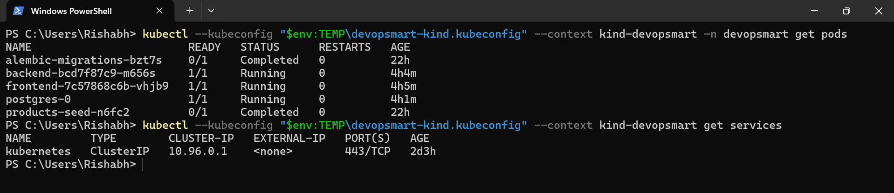

### 3. Deploying PostgreSQL with Persistent Storage

I deployed PostgreSQL using a StatefulSet and created a PersistentVolumeClaim (PVC) with 1 GiB of storage.

I used a ConfigMap for non-sensitive database configuration and a Kubernetes Secret for the database password.

The database runs inside the `devopsmart` namespace and is exposed through a Kubernetes Service, which allows the backend to connect to it using the service name `postgres`.

I also kept the Kubernetes database separate from the PostgreSQL volume used by Docker Compose.

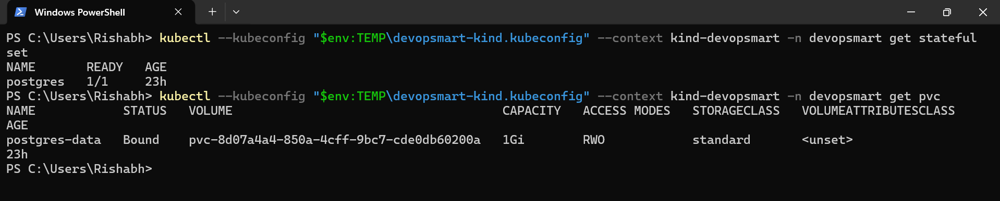

### 4. Running Database Migrations and Seeding Products

After PostgreSQL became ready, I ran the existing Alembic migrations through a Kubernetes Job.

The migrations created the required database tables for products, orders, and order items.

I then used a separate Kubernetes Job to insert the six sample products into the database. The existing seed script is idempotent, so it avoids inserting duplicate products when run again.

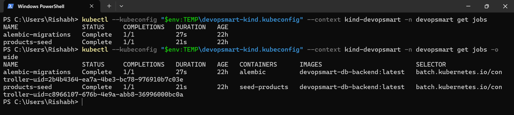

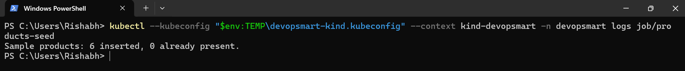

### 5. Deploying the FastAPI Backend

I deployed the FastAPI backend using a Kubernetes Deployment and exposed it through a ClusterIP Service on port `8000`.

The backend receives its database configuration from the ConfigMap and database password from the Kubernetes Secret.

I configured health probes and resource requests and limits for the container.

After deployment, I verified the following endpoints:

- `/health` – checks whether the backend is running.
- `/health/db` – checks the database connection.
- `/api/v1/products` – returns the products stored in PostgreSQL.

All six seeded products were returned successfully.

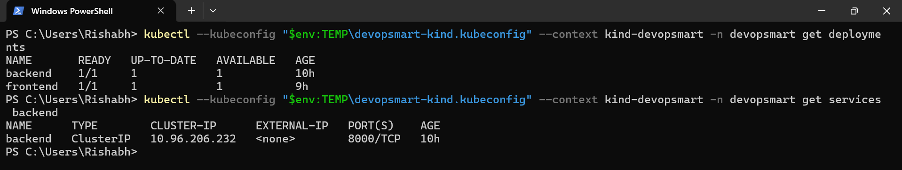

### 6. Deploying the React Frontend

I deployed the React frontend using a separate Kubernetes Deployment and exposed it through a ClusterIP Service on port `8080`.

The frontend uses Nginx to serve the built React application and forward API requests to the FastAPI backend.

I also configured readiness and liveness probes using the `/healthz` endpoint.

After deployment, I verified that the storefront loaded correctly and that product requests were successfully forwarded through Nginx to the backend.

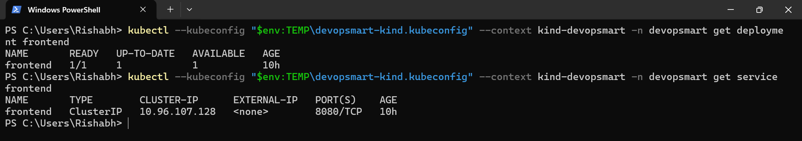

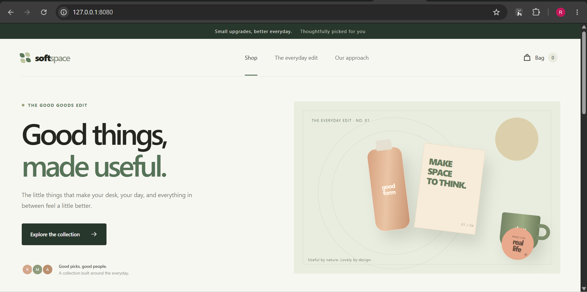

### 7. End-to-End Application Testing

Once all three services were running, I tested the complete application flow:

**React Frontend → Nginx → FastAPI Backend → PostgreSQL**

I added a temporary test product and placed one test order through the frontend. Since the application does not currently have a product creation API, I used one approved direct SQL insert to create the temporary product.

I verified that the order and its corresponding order item were saved correctly in PostgreSQL.

After testing, I removed only the temporary test records. The six original seeded products and their stock quantities remained unchanged.

The final database state was:

| Database records | Final count |
|---|---:|
| Products | 6 |
| Orders | 0 |
| Order items | 0 |

### 8. Testing Kubernetes Recovery and Data Persistence

I also tested how Kubernetes handles pod failures.

I deleted the frontend and backend pods individually and verified that their Deployments automatically created replacement pods.

I then deleted the PostgreSQL pod using normal graceful deletion. The StatefulSet recreated it and attached the same PersistentVolumeClaim.

After recovery, I checked the database again. All six products and their original stock quantities were still present.

The recovery tests confirmed that Kubernetes could recreate the application pods and that PostgreSQL data persisted across pod recreation.

### Kubernetes Deployment Summary

- Local Kubernetes cluster created using kind.
- Frontend, backend, and PostgreSQL deployed in the `devopsmart` namespace.
- Kubernetes Deployments, StatefulSet, Services, ConfigMaps, Secrets, Jobs, and PVC configured.
- Database migrations and product seeding completed through Kubernetes Jobs.
- Frontend-to-backend communication verified through Nginx.
- End-to-end order creation and database verification completed.
- Pod recovery and PostgreSQL data persistence tested successfully.

The entire setup runs locally using Docker Desktop and kind, without requiring cloud infrastructure.

## How to run the application

1-install docker desktop and check these commands
docker --version
docker compose version
git --version

2-clone the project from the github
cd Desktop
git clone YOUR_GITHUB_REPOSITORY_URL
cd DevOpsMart

3-configure env file
Copy-Item database/.env.example database/.env
notepad database/.env

4-Docker cotainers build and start
command-  docker compose --env-file database/.env -f compose.yaml -p devopsmart-db up -d --build
this will do
Builds the frontend Docker image.
Builds the backend Docker image.
Creates and starts the PostgreSQL container.
Connects all three services through a Docker network.
Creates a persistent volume for the database.
Runs all containers in the background.

5-check status of containers
command-  docker compose --env-file database/.env -f compose.yaml -p devopsmart-db ps
all containers should be healthy

6- open application in the browser
http://localhost:8080/
backend helath check    http://localhost:8000/health

7-verify postgress database
docker exec -it devopsmart-db-postgres-1 psql -U devopsmart -d devopsmart
product verify = SELECT * FROM products;
orders verify =SELECT * FROM orders;
order items verify =SELECT * FROM order_items;

for stop the application
docker compose --env-file database/.env -f compose.yaml -p devopsmart-db stop

to start the application
docker compose --env-file database/.env -f compose.yaml -p devopsmart-db start